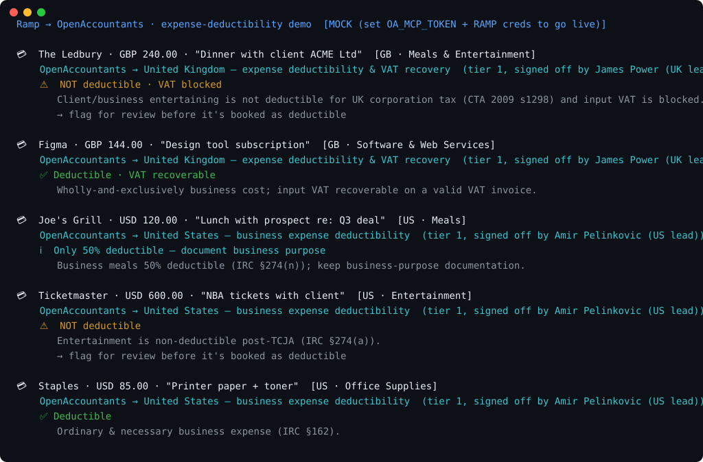

# Ramp → OpenAccountants: expense-deductibility demo

Demonstrates expense deductibility and VAT recoverability checks on Ramp-shaped transactions using OpenAccountants sample rules, with an optional live MCP connection.

Default runs use bundled sample responses. Their rates, verdicts and reviewer labels are illustrative fixtures, not evidence that an accountant reviewed the demo or a live skill. For live use, check the fetched skill's review status, reviewer, version and review date against the [review method](https://www.openaccountants.com/review-method). A jurisdiction lead's name alone does not establish review. Have a qualified professional review outputs before filing or acting on them.

```
Ramp transaction
  └─ { merchant, amount, category, memo, jurisdiction }
        └─ OpenAccountants MCP  →  load the deductibility skill for that jurisdiction
              └─ Verdict:  ✅ deductible (VAT recoverable)
                           ℹ️  only 50% deductible — document it
                           ⚠️ NOT deductible / VAT blocked   ← the catch
                 · the rule that decided it (cited)
                 · the skill's published review status, if present
```



> Regenerate the visual: `python make_svg.py` (static SVG, no deps) · animated GIF: `brew install vhs && vhs demo.tape`

## Why this is a partnership, not an overlap

- **Ramp = the spend rail.** Cards, transactions, clean categorization. Stops (by design) at *what the expense was*.
- **OpenAccountants** loads skill content through MCP for expense deductibility and VAT/GST recoverability checks. Review status varies by skill version.

A correct *category* ("Meals & Entertainment") is not a correct *tax treatment*. Ramp's finance/AP customers ask "…can we actually deduct this? can we reclaim the VAT?" right after categorization — and nothing in the pipeline answers it. This does, and it makes Ramp's data more valuable without Ramp building regulated, jurisdiction-specific tax logic or recruiting a CPA network.

## What it shows

A sample transaction feed across two jurisdictions, run through the OpenAccountants MCP:

| Transaction | Jurisdiction | Verdict |
|---|---|---|
| The Ledbury — "Dinner with client" | GB | ⚠️ **NOT deductible · VAT blocked** |
| Figma subscription | GB | ✅ Deductible · VAT recoverable |
| Joe's Grill — "Lunch with prospect" | US | ℹ️ Only 50% deductible — document it |
| Ticketmaster — "NBA tickets with client" | US | ⚠️ **NOT deductible** (entertainment, post-TCJA) |
| Staples — office supplies | US | ✅ Deductible |

**The money shot:** Ramp categorizes the £240 client dinner cleanly as "Meals & Entertainment." **OpenAccountants is the layer that knows UK client entertainment isn't deductible and the input VAT is blocked** (CTA 2009 s1298); and that the same kind of expense is treated differently in the US (50% for meals, 0% for entertainment). The sample rule illustrates the distinction; check live skill review status separately.

## Run it

```bash
git clone https://github.com/openaccountants/ramp-expense-demo
cd ramp-expense-demo
python pipeline.py                      # bundled sample feed (mock mode, no keys)
python pipeline.py samples/transactions.json
```

### Go live

```bash
export OA_MCP_TOKEN=...          # OpenAccountants account token (the MCP requires auth)
export RAMP_CLIENT_ID=...        # Ramp OAuth client (self-serve in Ramp → Developer)
export RAMP_CLIENT_SECRET=...
python pipeline.py
```

- With `OA_MCP_TOKEN`, `oa_client.py` calls the live MCP (`start` → `get_skill`); skill content comes back live; inspect its review status and reviewer fields.
- With Ramp credentials, `ramp_client.py` pulls real transactions instead of the bundled sample.
- With neither, it runs on the sample feed so the flow is visible today.

## Files

| File | Role |
|------|------|
| `pipeline.py` | Orchestrator + CLI: Ramp → OA → verdict report |
| `ramp_client.py` | Ramp transaction extraction (live API or bundled sample) |
| `oa_client.py` | OpenAccountants MCP JSON-RPC client (live or mock) |
| `deductibility_check.py` | Classifies the expense + applies the loaded OA rules → verdict |
| `samples/transactions.json` | Ramp-shaped transaction feed |

## Honest notes

- `deductibility_check.py` is a **deliberate simplification**; a keyword classifier + a handful of categories per jurisdiction, enough to make the demo land. In production the OA *skill* carries the full rule set and an AI agent reasons over it; professional review must be established for the specific skill version and your facts.
- Reviewer names in bundled responses are fixture labels. In live mode, inspect the actual `get_skill` response and its review record; a lead's name is not proof of review.
